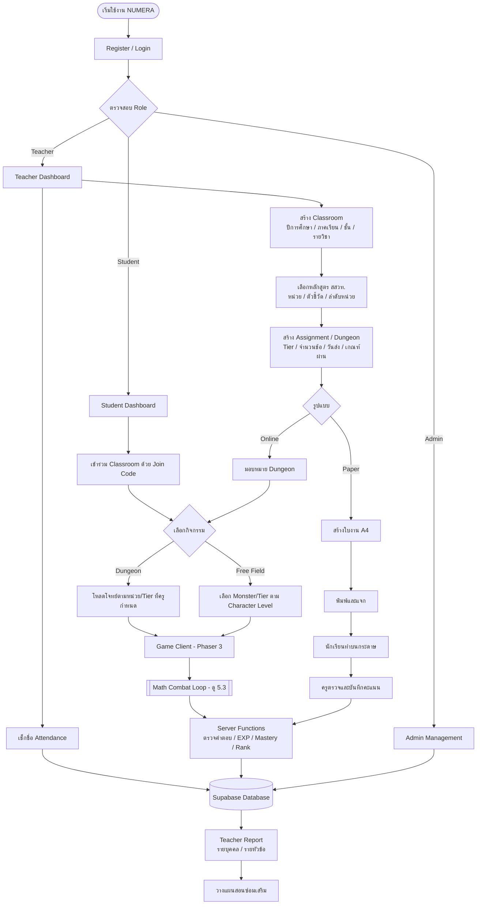
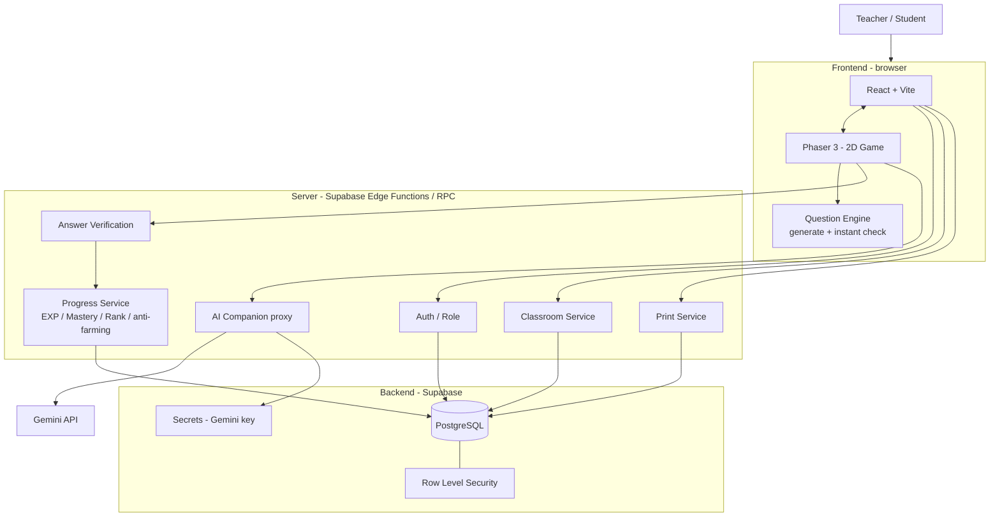
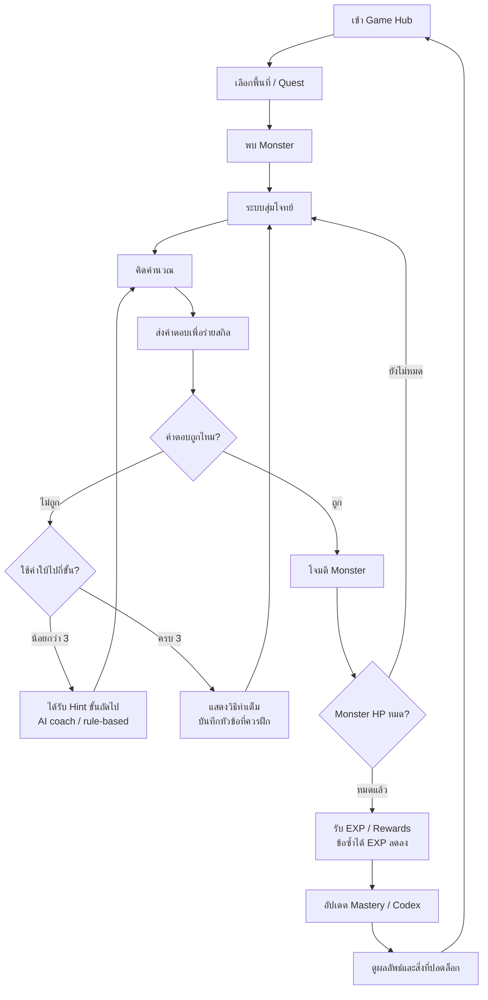
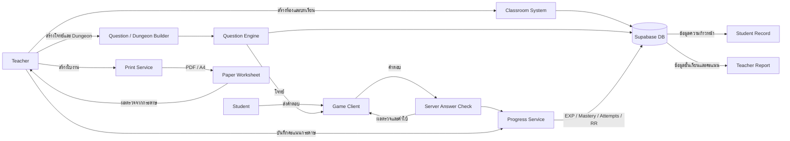
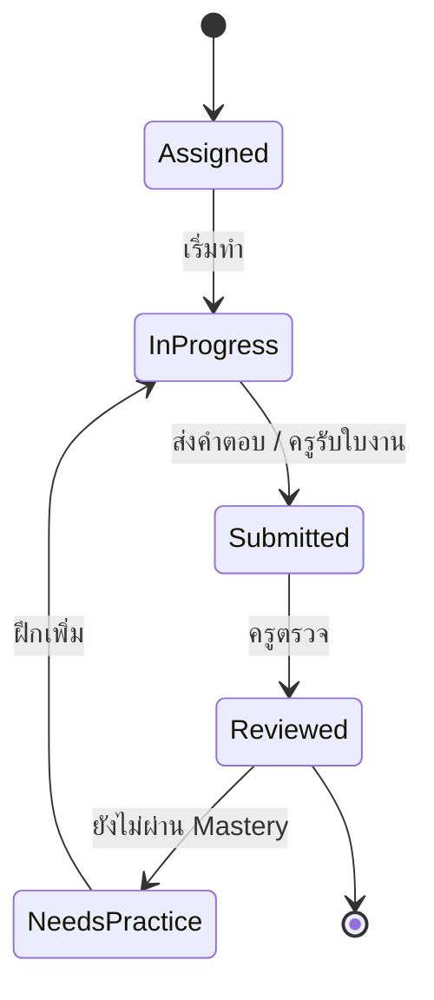

# NUMERA — อาณาจักรแห่งตัวเลข

**LEARN • CAST • LEVEL UP**

NUMERA is a math learning web platform for lower-secondary students (ม.1–ม.3).
It combines a teacher **Classroom** system with a small **2D MMORPG-lite game**.
Students cast spells by solving math problems, and teachers assign "Dungeons" as
homework linked to units of the สสวท. (IPST) curriculum.

> This README is the project's shared memory: what we are building, decisions
> made so far, and what to do next. Update it whenever a decision changes.

---

## 1. Project at a glance

| Item | Detail |
|---|---|
| Type | Educational web app + game-based learning |
| Users | Students ม.1–ม.3, math teachers, admin |
| Curriculum | หลักสูตรแกนกลาง 2551 (ฉบับปรับปรุง 2560), สสวท. standards/indicators as reference |
| Devices | Computer / tablet / phone, plus printable A4 worksheets (Paper Mode) |
| Prototype timeline | ~8 weeks (MVP-first) |
| Source document | `ข้อเสนอโครงงาน_ฉบับปรับปรุง.docx` (project proposal, Thai) |

### Core principle

Students win by **solving problems and explaining their thinking**, not by
clicking fast or grinding. Progress is split into three separate tracks:

| Track | Earned from | Used for |
|---|---|---|
| **Character Level / EXP** | battles, quests, practice | monster level in Free Field, cosmetics, zones. *Not* proof of learning |
| **Topic Mastery** | correctness across varied question types | unlocking next topics, teacher reports |
| **Prestige / Rank** | new (non-repeated) challenges, improvement, team help | titles, badges, opt-in season rank. Never affects school grades |

### Two ways to fight

- **Free Field**: practice/farming. Monster level and question Tier (T1–T4) come
  from **Character Level**, but questions stay inside the student's grade path.
- **Dungeon**: homework assigned by the teacher. Content is locked to the
  teacher's **unit / indicator / Tier / due date / pass rule**. 3–5 rooms + a boss.

### Question Tiers

| Tier | Description |
|---|---|
| T1 Familiar | same as worked example, one concept |
| T2 Practice | changed numbers/context, choose steps |
| T3 Apply | multi-step, connect concepts |
| T4 Mastery | mixed / new situation, explain reasoning |

---

## 2. MVP scope

**In MVP:** login + teacher/student roles · Classroom by academic year / semester /
grade / course · attendance · unit ordering · Dungeon/homework assignment ·
1 Hub + 1 Free Field zone · question bank (3–4 topics, teacher-approved) with
generator, answer check, solutions, hints · EXP, Mastery, basic titles/badges,
small opt-in leaderboard · hint companion · printable worksheets + paper score entry.

**Not in MVP:** large guilds/parties · real-time chat · open world / player economy ·
PvP · AI-generated questions without teacher review · OCR worksheet grading ·
multi-school leagues.

---

## 3. Tech stack

| Part | Technology |
|---|---|
| Web frontend | React + Vite (TypeScript) |
| 2D game | Phaser 3 |
| Database / Auth | Supabase (PostgreSQL + Auth + Row Level Security) |
| Server logic | Supabase Edge Functions / Postgres functions (RPC) |
| Question Engine | TypeScript modules + question templates |
| AI hints | Gemini API (Google AI Studio) via Edge Function, see §6 |
| Print | HTML/CSS A4 print layout / PDF export |
| Hosting | Static hosting + Supabase free tier |

---

## 4. Key decisions (decision log)

| # | Decision | Why |
|---|---|---|
| D1 | Character Level, Topic Mastery and Rank are separate | grinding must not skip lessons |
| D2 | Free Field scales by Character Level; Dungeon by teacher's unit/Tier | keeps homework aligned with the school's teaching plan |
| D3 | **Anything that counts is checked on the server** (Dungeon/Ranked answer checking, EXP, Mastery, RR, anti-farming) | with only static hosting + Supabase, client-side logic could be faked from the browser console |
| D4 | Free Field may check answers in the browser for instant feedback, but saved results are re-checked on the server | speed + security |
| D5 | Repeated questions give reduced/capped EXP and **no** rank points | anti-farming |
| D6 | Paper scores go through the Progress Service (same EXP/Mastery rules) | Paper Mode students must not be disadvantaged |
| D7 | Wrong answers never remove EXP, items or levels; speed is never the main criterion | reduce pressure, reward understanding |
| D8 | Leaderboards are opt-in, allow aliases, never show the bottom of the table | fairness, no shaming |
| D9 | **Gemini is a coach, not a judge** (see §6) | LLMs can make math mistakes |
| D10 | No API keys in frontend code or in this repo; keys live in Supabase secrets | security (proposal §9.4) |

---

## 5. Diagrams

### 5.1 Overall system flow

### 5.2 Architecture

### 5.3 Core gameplay loop

### 5.4 Data flow

### 5.5 Assignment status

---

## 6. AI hint companion (Gemini)

**Rule: the Question Engine is the source of truth. Gemini only coaches.**

1. Student asks for help → request goes to a **Supabase Edge Function** (the key never reaches the browser).
2. The function sends Gemini: question text, the **verified answer and solution steps**,
   the student's wrong answer, `common_mistakes`, and hint level.
3. Instructions: coach in Thai at ม.1–3 level, ask a guiding question, **never reveal the final answer**.
4. The reply is checked (contains the answer? too long?). If it fails, or Gemini is
   down / out of quota → fall back to the **teacher-written hint**.

| Hint level | Source |
|---|---|
| Hint 1–2 | Gemini rewrites the hint around the student's actual mistake |
| Hint 3 / full solution | stored, teacher-approved `solution_steps` (Gemini may only rephrase) |
| Grading, EXP, Mastery, Rank | **never** AI |

Other rules: teacher can switch AI on/off per class and see a log of AI hints;
daily request limit per student; companion only discusses the current question
(no open chat); send **no names or student IDs** to Gemini (PDPA).

### ⚠️ Open checks before using Gemini with students

- [ ] Read the current **Gemini API terms** at ai.google.dev. They have restricted apps used by people under 18; our users are 12–15.
- [ ] Get written OK from the advisor teacher / school IT admin for using it in a class trial.
- [ ] We use a **school Google account**: the key dies if the account is closed (e.g. after graduation). Document how to swap the key; rule-based hints keep the app working without it.
- [ ] Free tier: prompts may be used by Google, so keep sending no personal data.

---

## 7. Main data tables (from proposal §9.3)

`users` · `classrooms` · `class_members` · `attendance` · `curriculum_versions` ·
`course_plans` · `course_units` · `assignments` · `question_templates` · `attempts` ·
`progress` · `paper_results` · `player_profiles` · `rank_seasons` · `rank_records` ·
`achievements` · `monster_codex` · `bounty_progress` · *(new)* `ai_hint_logs`

Question template fields: `topic_id`, `grade_band`, `difficulty_tier`, `prompt_template`,
`generator_parameters`, `answer_rule`, `solution_steps`, `hint_steps`, `common_mistakes`,
`teacher_approved`, `curriculum_version`, `standard_ref`/`indicator_ref`, `source_note`.

---

## 8. 8-week plan

| Week | Work | Deliverable |
|---|---|---|
| 1 | Requirements, curriculum map (3–4 topics), user flow, wireframes | docs + wireframes |
| 2 | Accounts, roles, Classroom, join code, courses by year/semester | teacher creates class, student joins |
| 3 | Question Engine: templates, Tiers, answers, solutions, hints | 3–4 verified topics + answer tests |
| 4 | 2D Hub / Free Field, Battle UI, monster by Character Level | walk, meet monster, answer by Tier |
| 5 | Combat + EXP + Mastery + Dungeon locked to unit/Tier | Free Field and Dungeon rules separate |
| 6 | Teacher dashboard, attendance, reports, Paper Mode A4 | teacher sees status, prints worksheets |
| 7 | Codex, Bounty Board, titles, boss grades, opt-in rank, AI hints | anti-farming tested |
| 8 | Testing + small student trial (pre/post test, survey) | test report, demo-ready prototype |

---

## 9. Status & next steps

- [x] Proposal read and summarised
- [x] System diagrams reviewed and corrected (server-side checks, paper → progress, hint limit, statuses)
- [x] AI hint design decided (Gemini as coach, rule-based fallback)
- [ ] Confirm Gemini terms / school permission (§6)
- [ ] Project skeleton: React + Vite + TS, Phaser, Supabase schema + RLS
- [ ] Question Engine first topics: integers, fractions, linear equations

## References

1. สพฐ. (2560). ตัวชี้วัดและสาระการเรียนรู้แกนกลาง กลุ่มสาระการเรียนรู้คณิตศาสตร์ (ฉบับปรับปรุง พ.ศ. 2560). https://www.academic.obec.go.th/web/document/view/295
2. สสวท. คู่มือการใช้หลักสูตรคณิตศาสตร์ ระดับมัธยมศึกษาตอนต้น. https://www.ipst.ac.th/mathm
3. Li, Hew & Du (2024). Gamification meta-analysis. https://doi.org/10.1007/s11423-023-10337-7
4. Li, Liang, Fryer & Shum (2024). Leaderboards in education. https://doi.org/10.1111/jcal.13077

> สสวท. documents are used as a reference framework only. NUMERA is not endorsed by สสวท.
